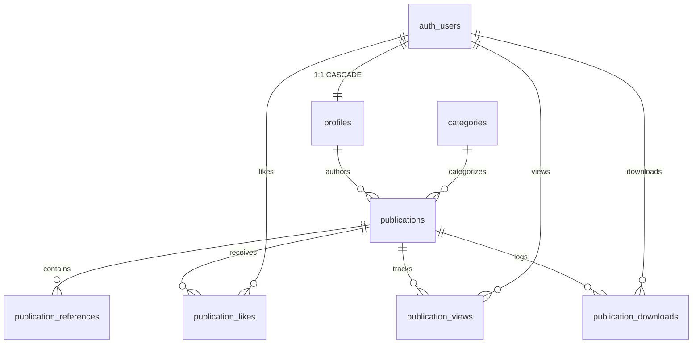

# QUAZION — Comprehensive Technical Architecture Audit Report

**Date of Audit:** November 2026  
**Audited Platform:** QUAZION Open Scientific Knowledge & Publishing Platform  
**Target Environment:** Next.js 16 (App Router) • React 19 • TypeScript 5 • Tailwind CSS v4 • Supabase (PostgreSQL)  
**Repository Working Directory:** `c:\sharon\projects\QUAZION` (`quazion/`)  

---

## Table of Contents

1. [Executive Summary](#1-executive-summary)
2. [Current Project Architecture](#2-current-project-architecture)
3. [Existing Route Inventory](#3-existing-route-inventory)
4. [Component Inventory](#4-component-inventory)
5. [Supabase Integration Status](#5-supabase-integration-status)
6. [Authentication Status](#6-authentication-status)
7. [Database Status & Schema Analysis](#7-database-status--schema-analysis)
8. [Functionality Assessment](#8-functionality-assessment)
9. [Technical Health & Issues](#9-technical-health--issues)
10. [Architecture Comparison & Missing Features](#10-architecture-comparison--missing-features)
11. [Recommended Implementation Order](#11-recommended-implementation-order)

---

## 1. Executive Summary

QUAZION is envisioned as a hybrid open scientific publishing platform that bridges peer-moderated academic papers, cosmological observations, theoretical physics research, and educational essays with zero paywalls.

### Current Condition Summary:
The project has established a **visually cohesive editorial frontend** (dark cosmic theme with cyan/blue accents and scientific typography) and a **well-conceived PostgreSQL schema** with Row Level Security. However, there is a **complete disconnection between the frontend presentation layer and the database persistence layer**:
- **Discovery and Reading UI** reads entirely from an in-memory/static file (`lib/mock-data.ts`), which is currently empty.
- **Creator Studio (`/creator/publications/new`)** simulates draft and publish actions with client-side timers (`setTimeout` and `alert()`), writing no data to Supabase.
- **Supabase integration** is functional only for authentication (`auth.signUp`, `auth.signInWithPassword`, and `auth.onAuthStateChange`).
- **Route protection** is absent: creator workspace routes are completely unprotected by middleware or session checks.

---

## 2. Current Project Architecture

### 2.1 Workspace & Folder Structure

```text
QUAZION/                                  # Root Workspace
├── package.json                          # Workspace script delegation to quazion/
├── README.md                             # Root project overview
└── quazion/                              # Primary Application Repository
    ├── app/                              # Next.js App Router root
    │   ├── about/page.tsx                # About & editorial mission
    │   ├── auth/
    │   │   ├── callback/route.ts         # Supabase OAuth/Magic Link SSR callback
    │   │   ├── login/page.tsx            # Unified Sign-In & Sign-Up interface
    │   │   └── signup/page.tsx           # Route redirecting/rendering sign-up
    │   ├── contributors/
    │   │   ├── [username]/page.tsx       # Contributor profile view
    │   │   └── page.tsx                  # Contributors directory
    │   ├── creator/
    │   │   ├── dashboard/page.tsx        # Author analytics & manuscript table
    │   │   └── publications/new/page.tsx # Paper authoring studio form
    │   ├── explore/page.tsx              # Scientific domain/category explorer
    │   ├── publications/
    │   │   ├── [slug]/page.tsx           # Full manuscript reader & viewer
    │   │   └── page.tsx                  # Filterable publication catalog
    │   ├── search/page.tsx               # Weighted full-text search interface
    │   ├── favicon.ico
    │   ├── globals.css                   # Tailwind v4 directives & cosmic theme tokens
    │   ├── layout.tsx                    # Root HTML layout with Navbar & Footer
    │   └── page.tsx                      # Landing homepage
    ├── components/
    │   ├── home/                         # Landing page sections (8 modular components)
    │   ├── layout/                       # Navbar & Footer
    │   ├── navigation/                   # AuthNav state switcher
    │   ├── publications/                 # 11 reader and card components
    │   └── ui/                           # Primitive Button and Badge components
    ├── docs/
    │   └── database/schema.md            # Schema design specifications
    ├── lib/
    │   ├── supabase/
    │   │   ├── client.ts                 # Browser Supabase client (@supabase/ssr)
    │   │   └── server.ts                 # Server Supabase client with cookie store
    │   ├── mock-data.ts                  # Static fallback dataset & category taxonomy
    │   └── utils.ts                      # Class merging utility (clsx + tailwind-merge)
    ├── public/                           # Static SVGs and icons
    ├── supabase/
    │   └── migrations/
    │       └── 001_initial_schema.sql    # Complete SQL DDL, triggers, and RLS policies
    ├── types/
    │   └── index.ts                      # TypeScript domain interfaces
    ├── .env.example                      # Template environment variables
    ├── .env.local                        # Local development environment keys (git-ignored)
    ├── .gitignore
    ├── next.config.ts
    ├── package.json
    └── tsconfig.json
```

### 2.2 Data Flow Architecture & Identified Bottleneck

```
[Browser / Reader]
       │
       ▼
[Next.js App Router] ──(Queries)──► [lib/mock-data.ts] (Static Arrays)
                                              ▲
                                              │  (Zero DB read operations)
[Supabase PostgreSQL] ◄───────────────────────┘
       ▲
       │  (Only Auth touches Supabase;
       │   all publication CRUD is disconnected)
[AuthNav / Login Page]
```

---

## 3. Existing Route Inventory

| Route Path | Type | Render Target | Current Data Source | Metadata Export | Status |
| :--- | :--- | :--- | :--- | :--- | :--- |
| `/` | Server Component | Homepage | `lib/mock-data.ts` | Inherited from Root Layout | **Functional UI** (Static) |
| `/about` | Server Component | About & Mission | Static JSX content | Static metadata export | **Fully Implemented** |
| `/explore` | Server Component | Category Browser | `lib/mock-data.ts` | Static metadata export | **Functional UI** (Static) |
| `/publications` | Client Component | Publication Catalog | `lib/mock-data.ts` | None (Client Component) | **Functional UI** (Empty state) |
| `/publications/[slug]` | Server Component | Paper Reader | `lib/mock-data.ts` | Dynamic `generateMetadata` | **Incomplete** (Hardcoded body) |
| `/contributors` | Server Component | Author Directory | `lib/mock-data.ts` | Static metadata export | **Functional UI** (Empty state) |
| `/contributors/[username]` | Server Component | Author Profile | `lib/mock-data.ts` | Dynamic `generateMetadata` | **Incomplete** (Reads mock array) |
| `/search` | Client Component | Archive Search | `lib/mock-data.ts` | Wrapped in `<Suspense>` | **Functional UI** (Client filter) |
| `/creator/dashboard` | Client Component | Author Dashboard | Local empty array | None | **Incomplete** (No live DB queries) |
| `/creator/publications/new`| Client Component | Authoring Form | Local state | None | **Incomplete** (Simulated save) |
| `/auth/login` | Client Component | Login & Sign-up | Supabase Auth API | Wrapped in `<Suspense>` | **Fully Implemented** |
| `/auth/signup` | Client Component | Signup View | Supabase Auth API | Redirects to `/auth/login` | **Fully Implemented** |
| `/auth/callback` | Route Handler | OAuth/SSR Callback | Supabase Auth SSR | N/A (API Route) | **Fully Implemented** |

---

## 4. Component Inventory

### 4.1 Layout & Navigation Components
- **`Navbar` (`components/layout/navbar.tsx`):**
  - *Type:* Client component (`use client`).
  - *Function:* Sticky header with brand logo, nav links (`Explore`, `Publications`, `Contributors`, `About`), search shortcut `/`, mobile drawer, and `AuthNav`.
  - *Status:* Responsive and operational.
- **`Footer` (`components/layout/footer.tsx`):**
  - *Type:* Server component.
  - *Function:* Semantic footer with mission notice, discipline links, editorial guidelines, and copyright.
  - *Status:* Operational.
- **`AuthNav` (`components/navigation/auth-nav.tsx`):**
  - *Type:* Client component (`use client`).
  - *Function:* Subscribes to `supabase.auth.onAuthStateChange`. Renders "Sign In" and "Sign Up" buttons when unauthenticated; renders "Dashboard" and "Sign Out" button when authenticated.
  - *Status:* Fully functional with Supabase Auth.

### 4.2 Home Components
- **`HeroSection` (`components/home/hero-section.tsx`):** Editorial headline, starlight glow, search bar trigger, trust badges (100% Open Access, 6 Domains, Peer Moderated, Transparent).
- **`CategorySection` (`components/home/category-section.tsx`):** Grid of 6 core scientific disciplines with dynamic icons (`Sparkles`, `Globe`, `Atom`, `Compass`, `Binary`, `Cpu`).
- **`FeaturedPublications` (`components/home/featured-publications.tsx`):** Curated research grid with fallback empty state.
- **`LatestPublications` (`components/home/latest-publications.tsx`):** Real-time publication feed with metadata badges and read time indicators.
- **`FeaturedContributors` (`components/home/featured-contributors.tsx`):** Grid of researcher cards with papers/views stats.
- **`ContributionCta` (`components/home/contribution-cta.tsx`):** Call-to-action banner inviting researchers to publish with zero fees.
- **`ContributorCard` (`components/home/contributor-card.tsx`):** Reusable researcher card with avatar initial, ORCID display, and profile link.
- **`GlobalSearchBar` (`components/home/global-search-bar.tsx`):** Controlled search input navigating to `/search?q=...`.

### 4.3 Publication Reading & Detail Components
- **`PublicationCard` (`components/publications/publication-card.tsx`):** Standard journal card with category badge, reading time, title, abstract snippet, tags, and stats.
- **`PublicationHeader` (`components/publications/publication-header.tsx`):** Manuscript title, publication type badge, category, author link, and dates.
- **`PublicationMeta` (`components/publications/publication-meta.tsx`):** Open-access CC BY 4.0 license badge, simulated DOI generator (`10.5281/quazion...`), one-click BibTeX citation exporter, and Web Share API button.
- **`PublicationContent` (`components/publications/publication-content.tsx`):** Long-form academic article renderer.
  - *Audit Finding:* Currently contains **hardcoded placeholder paper text** (equations, figures, tables for black hole merger study) rather than dynamically rendering `publication.content`.
- **`PublicationStats` (`components/publications/publication-stats.tsx`):** Telemetry row with `LikeButton`, `DownloadButton`, and view count.
- **`LikeButton` (`components/publications/like-button.tsx`):** Optimistic like counter with local toggle state. (Does not persist to `publication_likes` table).
- **`DownloadButton` (`components/publications/download-button.tsx`):** Triggers client-side text/plain blob download. (Does not log to `publication_downloads` table).
- **`AuthorSummary` (`components/publications/author-summary.tsx`):** Sidebar author bio card with affiliation and ORCID badge.
- **`RelatedPublicationCard` (`components/publications/related-publication-card.tsx`):** Mini card for sidebar recommendations.
- **`CategoryBadge` (`components/publications/category-badge.tsx`):** Colored domain pills.
- **`Tag` (`components/publications/tag.tsx`):** Hash-tagged keyword pill.

### 4.4 UI Primitives
- **`Button` (`components/ui/button.tsx`):** Polymorphic button with variants (`primary`, `secondary`, `outline`, `ghost`) and sizes (`sm`, `md`, `lg`).
- **`Badge` (`components/ui/badge.tsx`):** Status indicator with variants (`default`, `accent`, `success`, `warning`, `outline`).

---

## 5. Supabase Integration Status

### 5.1 Client Architecture
- **Browser Client (`lib/supabase/client.ts`):**
  - Utilizes `@supabase/ssr` `createBrowserClient`.
  - Injects `NEXT_PUBLIC_SUPABASE_URL` and `NEXT_PUBLIC_SUPABASE_ANON_KEY`.
  - Includes safe fallback values if environment variables are not yet loaded.
  - *Status:* Correctly implemented.
- **Server Client (`lib/supabase/server.ts`):**
  - Utilizes `@supabase/ssr` `createServerClient`.
  - Asynchronously handles `cookies()` from `next/headers` (compatible with Next.js 16 dynamic headers).
  - Implements `getAll()` and `setAll()` with try/catch block to prevent server component mutation errors.
  - *Status:* Correctly implemented.

### 5.2 Environment Configuration
- `.env.example` lists:
  - `NEXT_PUBLIC_SUPABASE_URL`
  - `NEXT_PUBLIC_SUPABASE_ANON_KEY`
  - `SUPABASE_SERVICE_ROLE_KEY`
- `.env.local` is present in the workspace, properly listed in `.gitignore`, and successfully loaded by the Next.js runtime.
- *Security Audit:* No secret credentials or service role keys are exposed to client-side bundles.

---

## 6. Authentication Status

### 6.1 Implemented Features
1. **Email & Password Authentication:**
   - Sign-Up: Collects Display Name, Username, Affiliation (optional), Email, and Password (min 6 characters).
   - Sign-In: Authenticates with email and password via `supabase.auth.signInWithPassword`.
   - Error Handling: Displays in-app alert cards for duplicate emails, invalid credentials, or weak passwords.
   - Profile Sync: Upserts into `public.profiles` upon successful sign-up.
2. **Session Persistence & State:**
   - `AuthNav` uses `supabase.auth.onAuthStateChange` to listen to login, logout, and token refresh events reactively.
   - Logout clears user state and triggers Next.js router refresh.
3. **OAuth Infrastructure:**
   - Route handler `/auth/callback/route.ts` exchanges auth code for session tokens and upserts profile details.
   - Google OAuth button is present on `/auth/login`.

### 6.2 Identified Authentication Gaps
1. **Google OAuth Unconfigured in Supabase:**
   - Attempting to sign in with Google yields `{"code":400, "error_code":"validation_failed", "msg":"Unsupported provider: provider is not enabled"}` because Google Cloud Console credentials have not been configured in the Supabase Dashboard.
   - *Mitigation in place:* An in-app warning instructs users to use Email/Password or configure Google in the dashboard.
2. **Missing Route Protection Middleware:**
   - No `middleware.ts` exists in the project.
   - Routes `/creator/dashboard` and `/creator/publications/new` can be directly accessed in the browser without an active session.

---

## 7. Database Status & Schema Analysis

### 7.1 Entity Relationship Model



### 7.2 Tables & Integrity Constraints

| Table Name | Purpose | Primary Key | Foreign Keys | Key Constraints |
| :--- | :--- | :--- | :--- | :--- |
| `profiles` | Researcher public identity | `id` (UUID) | `auth.users(id)` ON DELETE CASCADE | `username UNIQUE` |
| `categories` | Scientific disciplines | `id` (UUID) | None | `name UNIQUE`, `slug UNIQUE` |
| `publications` | Manuscripts & papers | `id` (UUID) | `category_id -> categories(id)`<br/>`author_id -> profiles(id)` | `slug UNIQUE`, default stats = 0 |
| `publication_references` | Bibliographic citations | `id` (UUID) | `publication_id -> publications(id)` | Order index default 0 |
| `publication_likes` | Interaction deduplication | `id` (UUID) | `publication_id`, `user_id` | `UNIQUE(pub_id, user_id)`, `UNIQUE(pub_id, ip_hash)` |
| `publication_views` | Telemetry analytics | `id` (UUID) | `publication_id`, `viewer_id` | Timestamped log |
| `publication_downloads` | Asset access logs | `id` (UUID) | `publication_id`, `user_id` | Timestamped log |

### 7.3 Enums & Types
1. `user_role`: `READER`, `CREATOR`, `REVIEWER`, `EDITOR`, `ADMIN`
2. `publication_status`: `DRAFT`, `SUBMITTED`, `PUBLISHED`, `REVISION_REQUIRED`, `REJECTED`, `ARCHIVED`
3. `publication_type`: `Research Paper`, `Review Article`, `Scientific Note`, `Research Report`, `Observation Report`, `Educational Article`, `Tutorial`, `Lecture Note`, `Editorial`, `Science Essay`, `Commentary`

### 7.4 Database Functions & Triggers
- **Full-Text Search Trigger (`publications_search_vector_trigger`):**
  - Trigger function executed `BEFORE INSERT OR UPDATE` on `publications`.
  - Weights Title (`A`), Abstract (`B`), and Keywords array (`C`) into a stored `tsvector`.
  - Indexed via GIN index `publications_search_idx`.
- **Automatic User Profile Creation (`handle_new_user`):**
  - `SECURITY DEFINER` trigger executed `AFTER INSERT` on `auth.users`.
  - Automatically provisions a `public.profiles` row with fallback username and display name.

### 7.5 Database Vulnerabilities & Schema Gaps Identified
1. **Missing RLS Policies on Interaction Tables:**
   - In `001_initial_schema.sql`, RLS is enabled on `publication_likes`, `publication_views`, and `publication_downloads`, but **no `CREATE POLICY` statements were defined** for them.
   - *Impact:* Because PostgreSQL defaults to denying all access when RLS is active with zero policies, client queries to log views, likes, or downloads will be blocked by RLS.
2. **Missing Storage Buckets:**
   - No Supabase Storage buckets exist for PDF document uploads (`document_url`), manuscript figures, or author avatars (`avatar_url`).

---

## 8. Functionality Assessment

| Feature Area | Sub-Feature | Implementation Status | Assessment Details |
| :--- | :--- | :--- | :--- |
| **Navigation** | Desktop Navbar Links | **Functional** | Smooth navigation between all core pages. |
| | Mobile Drawer Navigation | **Functional** | Responsive toggle with backdrop blur. |
| | Keyboard Shortcut `/` | **Functional** | Directs focus to `/search`. |
| **Search & Discovery** | Global Search Bar | **Functional** | Query params synchronize with `/search?q=...`. |
| | Full-Text Filter | **Partially Implemented** | Filters client-side `mock-data.ts`. Not yet linked to Supabase PostgreSQL GIN `search_vector`. |
| | Category Filter | **Functional (UI)** | Filter dropdown dynamically filters loaded records. |
| | Publication Type Filter | **Functional (UI)** | Filters across all 11 scientific publication types. |
| | Sorting (Newest, Views, Likes)| **Functional (UI)** | Sorter function operates on in-memory array. |
| **Authentication** | Email & Password Sign-up | **Functional** | Creates user in Supabase Auth & inserts profile. |
| | Email & Password Sign-in | **Functional** | Authenticates session and updates `AuthNav`. |
| | Google OAuth Sign-in | **Non-Functional** | Blocked because Google Provider is unconfigured in Supabase. |
| | Sign Out | **Functional** | Revokes session and refreshes UI. |
| **Creator Studio** | Creator Dashboard Load | **Partially Implemented** | Renders metrics and empty state, but does not fetch user's papers from DB. |
| | Publication Authoring Form | **Partially Implemented** | Validates form fields, slug auto-generation works, preview modal works, but Save/Submit runs a timer and does not write to DB. |
| | Protected Routes Guard | **Non-Functional** | No middleware or session check on `/creator/*`. |
| **Reading Experience**| Paper Reader (`/publications/[slug]`)| **Partially Implemented** | Header and metadata render dynamically from slug lookup, but main body contains hardcoded black hole merger text. |
| | BibTeX Citation Exporter | **Functional** | Copies valid BibTeX entry to clipboard. |
| | Like Counter Interaction | **Partially Implemented** | Client-only optimistic toggle; no DB persistence. |
| | Document Download Action | **Partially Implemented** | Generates a mock text blob; no storage bucket asset. |

---

## 9. Technical Health & Issues

### 9.1 Framework & Environment Details
- **Next.js:** `16.3.5` (App Router)
- **React:** `19.2.8`
- **TypeScript:** `5.9.3`
- **Node.js:** `v24.13.0`
- **Styling:** `@tailwindcss/postcss` & `tailwindcss` v4.0

### 9.2 Build & Code Quality Diagnostics
- **TypeScript Compilation (`npx tsc --noEmit`):**
  - **0 Errors.** All types, props, and interfaces pass strict type checking cleanly.
- **ESLint Analysis (`npm run lint`):**
  - **0 Errors.**
  - **1 Warning:** `app/creator/dashboard/page.tsx:16:10` — `MOCK_PUBLICATIONS` is imported but unused (leftover after data removal).
- **Bundler Configuration:**
  - `package.json` scripts explicitly include `--webpack` to avoid known native SWC Windows binding issues with Turbopack.

### 9.3 Identified Code-Level Bugs
1. **Unsafe Array Access in `app/creator/publications/new/page.tsx`:**
   - Line 40: `const [categoryId, setCategoryId] = useState(MOCK_CATEGORIES[0].id);`
   - Line 102: `const selectedCategoryObj = MOCK_CATEGORIES.find(...) || MOCK_CATEGORIES[0];`
   - *Risk:* If `MOCK_CATEGORIES` is ever cleared or empty before database fetch, accessing `.id` on index 0 throws a runtime `TypeError: Cannot read properties of undefined`.
2. **Missing `<Suspense>` on Client Search Params:**
   - In Next.js 16, components consuming `useSearchParams()` must be wrapped in a `<Suspense>` boundary.
   - *Status:* `/search` and `/auth/login` are properly wrapped; no bailouts detected.

---

## 10. Architecture Comparison & Missing Features

Comparison between current implementation and the proposed full QUAZION scientific publishing ecosystem:

| Proposed Subsystem | Required Capability | Current Implementation Status | Gap / Required Change |
| :--- | :--- | :--- | :--- |
| **Public Scientific Archive** | Open access paper catalog, filtering, and reading | **80% UI / 0% DB** | Connect catalog and reader to Supabase `publications` table. |
| **Research + Learning Ecosystem** | Distinct tracks for Research Papers vs Educational Articles | **40% (Taxonomy only)** | Publication types exist in schema, but no separate learning paths or curricula UI exist. |
| **Creator Studio** | Manuscript drafting, editing, revision tracking, submission | **50% (Form UI only)** | Connect form to insert into `publications`, build edit draft route (`/creator/publications/[id]/edit`). |
| **Contributor Profiles** | Academic bio, verified ORCID, affiliations, paper bibliography | **60% (UI Scaffold)** | Query `profiles` table and dynamically aggregate author's published papers. |
| **Editorial Management** | Reviewer dashboard, manuscript moderation, status workflow | **0% (Unimplemented)** | Need moderator view for `status = 'SUBMITTED'` ➔ `PUBLISHED` or `REVISION_REQUIRED`. |
| **Publication Engine** | LaTeX/KaTeX equation rendering, figure viewer, AST parser | **20% (Raw strings)** | Need Markdown/KaTeX renderer component to render LaTeX equations dynamically. |
| **Personal Reading Library** | Bookmarks, reading history, saved citations | **0% (Unimplemented)** | Need `user_bookmarks` table and library page. |
| **Search & Discovery** | Multi-attribute, weighted full-text search index | **30% (Client substring)** | Connect `/search` to Supabase RPC calling Postgres `to_tsquery('english', ...)`. |
| **Scientific Visualizations** | Interactive charts, astronomical diagrams, data tables | **15% (Hardcoded demo figure)**| Figure container exists in reader, but lacks dynamic charting library (e.g. Recharts or Chart.js). |

---

## 11. Recommended Implementation Order

To safely transition QUAZION from a static UI prototype to a fully dynamic, production-grade scientific platform without regressions, follow this staged roadmap:

### Phase 1: Supabase Data Wiring (Foundation)
1. **Seed Scientific Categories in Database:** Ensure categories exist in Supabase table `categories`.
2. **Dynamic Category Fetching:** Replace `MOCK_CATEGORIES` in `/explore`, `/publications`, and `/creator/publications/new` with database queries (`supabase.from('categories').select('*')`).
3. **Connect Authoring Form to Supabase:** Update `handleSaveDraft` and `handleSubmitForReview` in `app/creator/publications/new/page.tsx` to execute real `supabase.from('publications').insert(...)`.
4. **Wire Creator Dashboard:** Query `publications` where `author_id = user.id` to display real author papers, drafts, and aggregated stats.

### Phase 2: Public Archive & Reader Pipeline
1. **Connect Catalog (`/publications`):** Query `publications` where `status = 'PUBLISHED'` joined with `categories` and `author:profiles`.
2. **Dynamic Paper Reader (`/publications/[slug]`):** Replace hardcoded article content with dynamic markdown rendering of `publication.content`.
3. **Wire Contributor Profiles (`/contributors` & `[username]`):** Fetch researcher profiles from `profiles` and display their published manuscripts.

### Phase 3: Route Security & Missing RLS Policies
1. **Implement Next.js Middleware:** Add `middleware.ts` to protect `/creator/*` routes and redirect unauthenticated users to `/auth/login?next=/creator/dashboard`.
2. **Complete Interaction Table RLS:** Add `INSERT` and `SELECT` policies to `001_initial_schema.sql` for `publication_likes`, `publication_views`, and `publication_downloads`.
3. **Wire Telemetry:** Connect `LikeButton`, view tracking, and `DownloadButton` to write to interaction tables.

### Phase 4: Scientific Publishing Engine Enhancements
1. **LaTeX & KaTeX Parser:** Integrate `katex` and `react-markdown` with `remark-math` / `rehype-katex` for rendering mathematical proofs and formulas.
2. **Supabase Storage Integration:** Create storage buckets (`publication-documents`, `publication-covers`) to allow PDF and asset uploads.
3. **Editorial Moderation Pipeline:** Build an `/editor/moderation` dashboard for reviewing `SUBMITTED` manuscripts.

---

*Report compiled by the Technical Audit System for QUAZION.*

